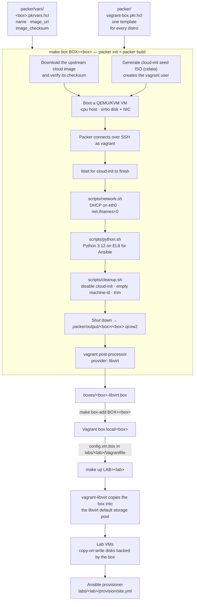

# Building boxes

Every lab VM boots from a Vagrant box that Packer builds locally from the distro's official
cloud image. No installer runs: Packer boots the cloud image, prepares it over SSH, and
packages the disk as a vagrant-libvirt box.

## Box pipeline



## Steps

1. Check the host once with `make readiness`. It boots an Ubuntu cloud image under
   Packer + QEMU/KVM and exits, proving KVM, `xorriso`, and the Packer plugins work.
2. Build a box: `make box BOX=rocky-8.10`. The output is `boxes/rocky-8.10-libvirt.box`;
   the intermediate qcow2 in `packer/output/` is removed by the post-processor.
3. Import it into Vagrant: `make box-add BOX=rocky-8.10`, which registers it as `local/rocky-8.10`.
4. Point a lab's `Vagrantfile` at `local/<box>` and run `make up LAB=<lab>`.

`make boxes` builds and imports every box in `packer/vars/` in one go. `make list` shows what
is buildable, what is imported, and which labs exist.

## What each provisioning script does

| Script | Why |
| --- | --- |
| `network.sh` | cloud-init's network config can pin the NIC to the build VM's MAC address. It is replaced with DHCP on `eth0`, and `net.ifnames=0` makes the first NIC `eth0` regardless of the PCI slot libvirt assigns. |
| `python.sh` | EL8 only ships Python 3.6, which current ansible-core cannot manage. Adds `python3.12` as `python3`. |
| `cleanup.sh` | Disables cloud-init (no seed ISO after the build), empties `machine-id` so every VM gets a unique one, cleans package caches, and trims free space. |

## Adding a distro

Create `packer/vars/<box>.pkrvars.hcl`:

```hcl
# Rocky Linux 9.4, pinned build
name           = "rocky-9.4"
image_url      = "https://dl.rockylinux.org/vault/rocky/9.4/images/x86_64/Rocky-9-GenericCloud-Base-9.4-20240609.1.x86_64.qcow2"
image_checksum = "file:https://dl.rockylinux.org/vault/rocky/9.4/images/x86_64/Rocky-9-GenericCloud-Base-9.4-20240609.1.x86_64.qcow2.CHECKSUM"
```

`make validate` and `make box BOX=<box>` pick it up automatically. Pin a dated image build
(as above) when you need a rebuild to produce the same release; use the distro's `latest`
image to track the newest point release.

## Gotchas

!!! warning "EL10 needs an x86-64-v3 CPU"
    Rocky/Alma 10 will not boot on QEMU's default CPU model. The Packer build passes
    `-cpu host`; in a lab's `Vagrantfile` set `lv.cpu_mode = "host-passthrough"`.

!!! note "Old box copies stay in the storage pool"
    Neither `vagrant box remove` nor re-importing a rebuilt box deletes the copy
    vagrant-libvirt made in the libvirt `default` pool. Prune them once no VM uses them.

```sh
virsh -c qemu:///system vol-list default | grep VAGRANTSLASH
virsh -c qemu:///system vol-delete --pool default <volume>
```
