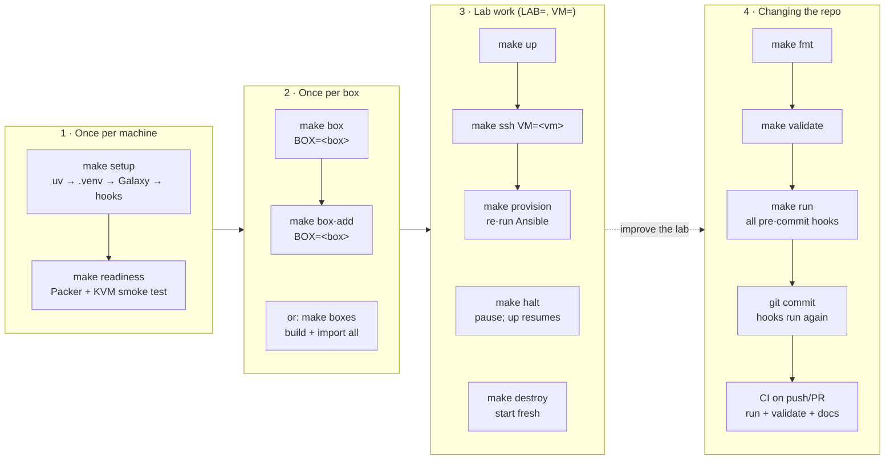

# Using the Makefile

The `Makefile` is the entry point for everything: tooling, boxes, labs, and docs. Run
`make help` for the full list. Most targets take one of three variables:

| Variable | Default | Used by |
| --- | --- | --- |
| `BOX` | `rocky-8.10` | `box`, `box-add`: a file name from `packer/vars/` without `.pkrvars.hcl` |
| `LAB` | `cert-lab` | Vagrant targets: a directory under `labs/` |
| `VM` | *(all)* | Vagrant targets: one machine in the lab, e.g. `VM=root-ca` |

## Workflow



`make docs` previews this site while you edit, and `make update` bumps `uv.lock` and the
pre-commit hook revs. Targets that depend on others run them first: `setup` runs `install-uv`, `sync`, and `galaxy`;
`validate`, `box`, and `readiness` run `init` (Packer plugins). Every target puts the repo's
`.venv/bin` first on `PATH`, so nothing needs activating.

## Common commands

```sh
make setup                              # new clone or new machine
make box BOX=rocky-9.4 && make box-add BOX=rocky-9.4
make up LAB=cert-lab                    # all three VMs
make ssh LAB=cert-lab VM=issuing-ca
make halt LAB=cert-lab VM=root-ca       # keep the root CA offline
make destroy LAB=cert-lab && make up LAB=cert-lab   # reset the lab
```

## All targets

--8<-- "README.md:make-targets"
